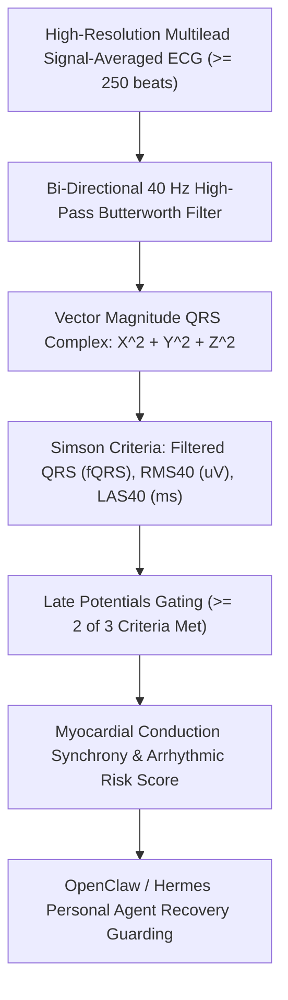

# Cardiac Ventricular Late Potentials (SAECG) Skill

[](LICENSE)
[](https://www.python.org/)
[](requirements.txt)
[](mcp_server.py)
[](SKILL.md)

Zero-dependency sovereign personal agent skill for non-invasive evaluation of Signal-Averaged ECG (SAECG) Ventricular Late Potentials (VLPs), terminal microvolt fragmentation, and arrhythmogenic substrate screening.



## Features
- **Deterministic Math**: Pure Python standard library implementation with zero external dependencies.
- **Electrophysiology Standards**: Implements validated Simson 40 Hz high-pass criteria for ventricular late potentials.
- **Myocardial Electrical Stability**: Highly sensitive detection of slow, fragmented conduction predisposing to re-entrant ventricular tachyarrhythmias.
- **Model Context Protocol (MCP)**: Native JSON-RPC tool integration for LLMs and autonomous agents.

## Quickstart

```python
from client import CardiacVentricularLatePotentialsClient

client = CardiacVentricularLatePotentialsClient()
result = client.evaluate_saecg(
    filtered_qrs_duration_ms=98.5,
    rms_40_uv=38.2,
    las_40_ms=24.0
)
print("VLP Positive:", result["vlp_positive"])
print("Synchrony Score:", result["myocardial_synchrony_score"])
print("Classification:", result["classification"])
```

## License
Apache-2.0
